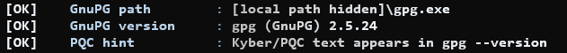
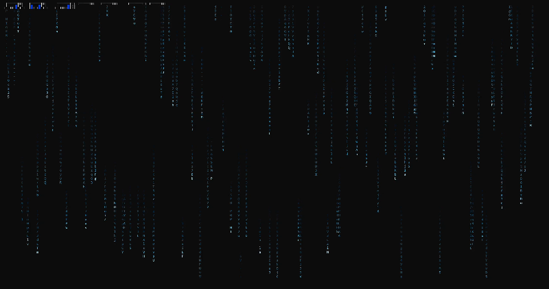
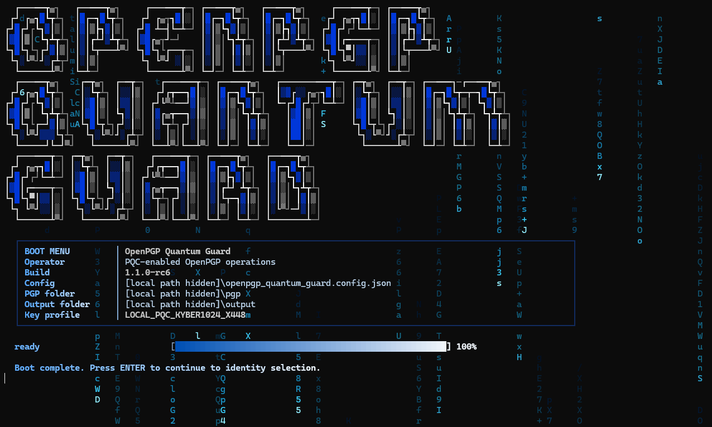

<p align="center">
  
  <p align="center">Experimental Windows PowerShell operator console for GnuPG file and text protection with PQC-capable composite Kyber/ML-KEM encryption subkeys.</p>
  <p align="center">
    <a href="https://github.com/RandomLinoge/OpenPGP-Quantum-Guard">
      
      
  
    </a>
  </p>
</p>

GnuPG performs the cryptographic operations. Quantum Guard provides a Windows PowerShell terminal interface and companion CLI for selecting keys, inspecting capabilities, and protecting files or text. This research preview has not received an independent security audit.

## Quick start on Windows

Install a PQC-capable build of GnuPG 2.5 or later, then open PowerShell in the repository root.

### 1. Prepare your local configuration

```powershell
$configPath = '.\src\openpgp_quantum_guard.config.json'
if (!(Test-Path -LiteralPath $configPath)) {
    Copy-Item -LiteralPath '.\config\openpgp_quantum_guard.config.example.json' -Destination $configPath
}
```

For a dedicated lab keyring, set `GpgHome` in your local configuration **before launching**. Leave it empty to use your default GnuPG home.

### 2. Launch Quantum Guard

```powershell
powershell.exe -NoProfile -ExecutionPolicy Bypass -File .\src\OpenPGP-Quantum-Guard.ps1
```

When the boot screen displays `ready`, press **Enter**. Select a disposable test identity if prompted, then open **Setup Doctor** from the main menu.

### 3. Verify your setup

Look for `[OK]` beside **GnuPG path** and **GnuPG version**. Check that the displayed version matches the build you intended to use.



If **GnuPG path** shows `[FAIL]`, set `GpgPath` in your local configuration to the full path to `gpg.exe`, then relaunch Quantum Guard.

Once both checks pass, continue to the [safe first test](#safe-first-test) to verify encryption and decryption with a disposable key.

## Safe first test

1. In a disposable GnuPG home, select a test identity with a hybrid encryption subkey and enable `RequirePqcEncryption`.
2. Encrypt a small file, decrypt it to a different path, and compare both files with `Get-FileHash -Algorithm SHA256`. The hashes should match.
3. With a classical-only test recipient, confirm encryption succeeds when PQC enforcement is off. Enable enforcement and repeat. The CLI should reject the recipient with exit code `4` and leave no ciphertext at the requested output path.

**Verified lab result:** At commit `80768f1`, the CLI help, static, and integration tests passed with GnuPG 2.5.24 and libgcrypt 1.12.4. The integration run used a `ky768_cv25519` hybrid subkey and an RSA classical control. It verified the SHA-256 round trip, policy rejection, overwrite protection, and invalid-fingerprint handling.

## Cryptographic scope
- Primary identity: Ed25519 for certification and signing.
- Strongest local PQC profile: ky1024_cv448, combining ML-KEM-1024 with X448 through GnuPG's composite OpenPGP implementation.
- Balanced PQC profiles: ky768_cv25519 and ky768_bp256.
- Compatibility profile: cv25519.
- Optional enforcement: RequirePqcEncryption adds GnuPG's --require-pqc-encryption policy to encryption operations.

GnuPG performs every cryptographic operation. This project does not implement ML-KEM or OpenPGP packet cryptography itself.

## Local configuration

Edit `src/openpgp_quantum_guard.config.json`. Leave the fingerprint empty for interactive selection or set a full primary fingerprint and expected UID hint. GnuPG pinentry handles passphrases. Store passphrases and private keys outside the configuration file. See the [configuration guide](config/README.md).

## Live Demo


## Command-line interface (CLI)
OpenPGP Quantum Guard now includes a companion command-line interface (CLI) alongside its interactive PowerShell terminal interface (TUI). 
The startup and keyboard instructions below apply to the TUI.


## TUI console boot

As startup advances, the stage label and progress bar update together on one line. Rain continues through the open space around the menu and between the label and the bar. When a shorter label replaces a longer one, the freed columns return to the animation. On compatible terminal dimensions, the falling streams carry their positions into the identity screen.

At ready, press Enter to continue to identity selection. To advance automatically, set "BootWaitForEnter": false in your local configuration.

## OpenPGP Quantum Guard - Main Menu


## Repository layout

- `src/` contains the TUI, CLI, and runtime artwork.
- `config/` contains the example configuration.
- `tests/` contains parser, privacy, CLI help, and integration checks.
- [Threat model](THREAT_MODEL.md) · [Compatibility](COMPATIBILITY.md) · [Security policy](SECURITY.md)

## Status and license

Peer review is welcome. The CLI results above cover the stated build and fixtures. Interactive Windows Terminal behavior and interoperability with other OpenPGP implementations require separate verification.

Open source under the [Apache License 2.0](LICENSE). See [Contributing](CONTRIBUTING.md) to report reproducible issues or propose improvements.
