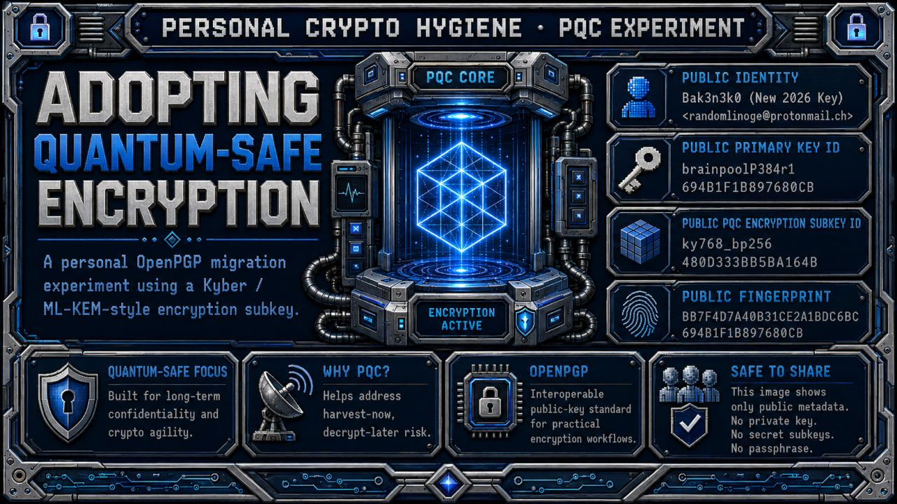

<p align="center">
  
  <p align="center">Experimental Windows PowerShell operator console for GnuPG file and text protection with PQC-capable composite Kyber/ML-KEM encryption subkeys.</p>
  <p align="center">
    <a href="https://github.com/RandomLinoge/OpenPGP-Quantum-Guard">
      
      
  
    </a>
  </p>
</p>

## OpenPGP Quantum Guard
OpenPGP Quantum Guard is an experimental Windows PowerShell operator console for GnuPG file and text protection. It supports classic OpenPGP profiles and GnuPG 2.5+ composite Kyber/ML-KEM encryption subkeys.

## Command-line interface (CLI)
OpenPGP Quantum Guard now includes a companion command-line interface (CLI) alongside its interactive PowerShell terminal interface (TUI). 
The startup and keyboard instructions below apply to the TUI.


## TUI console boot

As startup advances, the stage label and progress bar update together on one line. Rain continues through the open space around the menu and between the label and the bar. When a shorter label replaces a longer one, the freed columns return to the animation. On compatible terminal dimensions, the falling streams carry their positions into the identity screen.

At ready, press Enter to continue to identity selection. To advance automatically, set "BootWaitForEnter": false in your local configuration.

## Cryptographic scope
- Primary identity: Ed25519 for certification and signing.
- Strongest local PQC profile: ky1024_cv448, combining ML-KEM-1024 with X448 through GnuPG's composite OpenPGP implementation.
- Balanced PQC profiles: ky768_cv25519 and ky768_bp256.
- Compatibility profile: cv25519.
- Optional enforcement: RequirePqcEncryption adds GnuPG's --require-pqc-encryption policy to encryption operations.
GnuPG performs every cryptographic operation. This project does not implement ML-KEM or OpenPGP packet cryptography itself.

## Configure before testing
1. Install a GnuPG 2.5+ build that exposes Kyber/ML-KEM support.
2. Copy config/openpgp_quantum_guard.config.example.json to src/openpgp_quantum_guard.config.json.
3. Edit only that copied configuration file:
   - Leave GpgPath empty to use gpg.exe from PATH, or set its full path.
   - Leave GpgHome empty to use the default GnuPG home, or set a dedicated lab home.
   - Replace <OPENPGP_FINGERPRINT> with a full 40-hex-character primary fingerprint. You may leave it empty on first run and select a key interactively.
   - Replace the example UID hint with the UID you expect to see.
   - Keep RequirePqcEncryption set to true for PQC-only encryption tests.
4. Run:

```powershell
Set-ExecutionPolicy -Scope Process Bypass
& .\src\OpenPGP-Quantum-Guard.ps1
```

The script creates repository-relative data, output, and optional logos folders. Real passphrases must never be written into the configuration. GnuPG pinentry handles private-key unlocking.


## Safe first test
1. Open Setup doctor and verify the GnuPG executable, version, home, active identity, and PQC hints.
2. Generate or select a disposable lab key.
3. Encrypt a small test file using ky1024_cv448.
4. Decrypt it and compare its SHA-256 hash with the original.
5. Set RequirePqcEncryption to true and confirm encryption to a classic-only recipient fails.

## Repository layout
- src/: application script and local runtime configuration location.
- config/: reviewed example configuration.
- tests/: parser, privacy, and configuration checks.
- docs/: threat model and compatibility boundaries.
## Status
Peer review is needed.
## License
Apache License 2.0.
## Open Source
This project is open-source software. Its source code is publicly available for inspection, research, testing, modification, and contribution under the terms provided in the repository's LICENSE file.

Security testing, interoperability testing, responsible vulnerability reports, documentation improvements, and code contributions are welcome. This project is provided without any claim of an independent security audit or fitness for production use.
